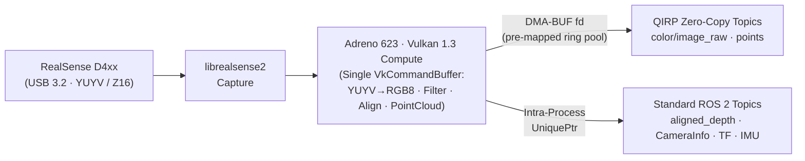

# `realsense_qcom_bolt`

[](https://docs.ros.org/en/jazzy/)
[](https://www.vulkan.org/)
[](package.xml)

Low-latency Intel RealSense RGB-D node for Qualcomm Dragonwing platforms (Arduino VENTUNO Q, QCS8275 / Adreno 623), built on **Vulkan 1.3 Compute** and **Qualcomm QIRP DMA-BUF Zero-Copy**.

Arduino VENTUNO Q ships with a solid Linux and ROS 2 foundation. `realsense_qcom_bolt` builds directly on that stack by offloading YUYV unpacking, depth filtering, depth-to-color alignment, and pointcloud generation onto the Adreno GPU in a single `VkCommandBuffer`, and passing output frames directly through pre-mapped QIRP DMA-BUF file descriptors.

---

## Architecture



### Key Characteristics

- **Single-Submission GPU Pipeline**: Executes color conversion (`YUYV → RGB8`), optional depth filtering (bilateral, temporal, range clipping), depth-to-color alignment, and pointcloud deprojection in one `VkCommandBuffer` submission per frameset.
- **QIRP DMA-BUF Zero-Copy**: Imports kernel DMA-BUF ring pool slots into Vulkan (`VK_KHR_external_memory_fd`) so the GPU writes `rgb8` images and `xyzrgb`/`xyz` pointclouds directly into transport memory (`qrb_ros::transport`), avoiding CPU staging copies.
- **Deterministic Fixed Presets (`P0`–`P6`)**: Routes startup parameters fail-fast to a fixed compute graph with zero runtime buffer reallocation. `P0` bypasses Vulkan initialization entirely (`0 VRAM`).
- **Standard ROS 2 Fallback**: Compiles and runs on non-Qualcomm Vulkan hosts with standard `sensor_msgs` when `-DBUILD_WITH_QIRP=OFF`.

---

## Performance (Intel RealSense D455)

Measured on **Arduino VENTUNO Q** (`QCS8275`, Ubuntu 24.04.5 LTS, kernel `6.8.0-1090-qcom`, ROS 2 Jazzy, USB 3.2 `5000M`).
Workload: simultaneous **RGB (`rgb8`) + Aligned Depth (`16UC1`) + Colorized PointCloud (`xyzrgb`)** (`P4`), 3-run mean (`8 s` warmup, `30 s` measurement).

| Profile (`Backend`) | Stack | PointCloud (Hz) | PointCloud Lat (ms) | PointCloud P95 (ms) | DMA-BUF (RGB/PC) | Total CPU (%) | CPU/Frame (ms) | Memory RSS (MB) |
| :--- | :--- | ---: | ---: | ---: | :---: | ---: | ---: | ---: |
| `640x360@90` (`v4l2`) | Official `realsense-ros` (Inter-Process) | 85.80 | 28.1 | 35.2 | 0% | 228.9 | 26.67 | 543.5 |
| | Official `realsense-ros` (Intra-Process) | 87.28 | 17.2 | 18.8 | 0% | 108.5 | 12.43 | 273.2 |
| | **`realsense_qcom_bolt` (Vulkan + QIRP)** | **89.84** | **16.0** | **17.2** | **100%** | **44.8** | **4.98** | **267.8** |
| `848x480@60` (`v4l2`) | Official `realsense-ros` (Inter-Process) | 56.83 | 73.9 | 110.0 | 0% | 227.1 | 39.96 | 664.4 |
| | Official `realsense-ros` (Intra-Process) | 59.26 | 27.6 | 29.5 | 0% | 105.3 | 17.77 | 296.2 |
| | **`realsense_qcom_bolt` (Vulkan + QIRP)** | **57.76** | **25.2** | **26.9** | **100%** | **35.1** | **6.08** | **271.9** |
| `1280x720@30` (`rsusb`) | Official `realsense-ros` (Inter-Process) | 25.04 | 191.1 | 304.1 | 0% | 219.3 | 87.66 | 876.9 |
| | Official `realsense-ros` (Intra-Process) | 29.20 | 55.3 | 57.7 | 0% | 109.8 | 37.60 | 412.1 |
| | **`realsense_qcom_bolt` (Vulkan + QIRP)** | **29.63** | **50.8** | **55.2** | **100%** | **41.8** | **14.10** | **322.4** |

> `100%` Total CPU equals one full CPU core (publisher + subscriber combined).

---

## Fixed Pipeline Presets

The node deterministically selects one preset at startup from stream and processing parameters:

| Preset | Active Outputs | PointCloud Frame | Vulkan |
| :---: | :--- | :---: | :---: |
| `P0_bypass_only` | Raw streams only (Color / Depth / IR / IMU) | — | Off (`0 VRAM`) |
| `P1_rgb_depth` | RGB + filtered Depth | — | On |
| `P2_rgb_aligned_depth` | RGB + Aligned Depth | — | On |
| `P3_rgb_pc_depth_frame` | RGB + Colorized PointCloud | `depth` | On |
| `P4_rgb_aligned_pc_depth_frame` | RGB + Aligned Depth + Colorized PointCloud | `depth` | On |
| `P5_rgb_aligned_pc_color_frame` | RGB + Aligned Depth + Colorized PointCloud | `color` | On |
| `P6_depth_pc_xyz` | Depth + XYZ PointCloud (no Color) | `depth` | On |

---

## Build & Quick Start

### Build

```bash
source /opt/ros/jazzy/setup.bash

# Qualcomm QIRP (VENTUNO Q)
colcon build --packages-select realsense_qcom_bolt \
  --cmake-args -DCMAKE_BUILD_TYPE=Release -DBUILD_WITH_QIRP=ON

# Standard ROS 2 + Vulkan host (without QIRP)
colcon build --packages-select realsense_qcom_bolt \
  --cmake-args -DCMAKE_BUILD_TYPE=Release -DBUILD_WITH_QIRP=OFF
```

### Launch

```bash
source install/setup.bash

# Default: 848x480@60, P4 (RGB + Aligned Depth + PointCloud), QIRP DMA-BUF enabled
ros2 launch realsense_qcom_bolt bolt.launch.py

# Color-frame pointcloud (P5) at 640x360@90
ros2 launch realsense_qcom_bolt bolt.launch.py \
  color_profile:=640x360x90 depth_profile:=640x360x90 coord_frame:=color
```

---

## Topics & Parameters

### Published Topics

| Topic | Type (`QIRP ON` / `OFF`) | Condition |
| :--- | :--- | :--- |
| `~/color/image_raw` | `qrb_ros::transport::type::Image` / `sensor_msgs/Image` (`rgb8`) | `enable_color:=true` |
| `~/depth/image_rect_raw` | `sensor_msgs/Image` (`16UC1`) | `enable_depth:=true` |
| `~/aligned_depth_to_color/image_raw` | `sensor_msgs/Image` (`16UC1`) | `align_depth.enable:=true` |
| `~/depth/color/points` | `qrb_ros::transport::type::PointCloud2` / `sensor_msgs/PointCloud2` | `P3` / `P4` |
| `~/aligned_depth_to_color/points` | `qrb_ros::transport::type::PointCloud2` / `sensor_msgs/PointCloud2` | `P5` (`coord_frame:=color`) |
| `~/depth/points` | `qrb_ros::transport::type::PointCloud2` / `sensor_msgs/PointCloud2` | `P6` (`enable_color:=false`) |
| `~/infra1/image_rect_raw`, `~/infra2/image_rect_raw` | `sensor_msgs/Image` (`y8` / `y16`) | `enable_infra1/2:=true` |
| `~/gyro/sample`, `~/accel/sample`, `~/imu` | `sensor_msgs/Imu` | `enable_gyro/accel:=true` |

Each enabled image stream publishes its matching `*/camera_info`, and static optical transforms are broadcast when `publish_tf:=true`.

### Key Parameters

| Parameter | Default | Mutability | Description |
| :--- | :--- | :---: | :--- |
| `rgb_camera.color_profile` / `depth_module.depth_profile` | `848x480x60` | Startup | Stream resolution and FPS (`WxHxFPS`) |
| `align_depth.enable` / `pointcloud.enable` | `true` / `true` | Startup | Enables alignment and pointcloud stages |
| `pointcloud.coord_frame` | `depth` | Startup | PointCloud frame: `depth` (`P4`) or `color` (`P5`) |
| `use_qirp_transport` | `false` (`true` in launch) | Startup | Enables QIRP DMA-BUF Zero-Copy transport |
| `qirp_dmabuf_pool_size` | `8` (`0`–`32`) | Startup | Pre-mapped DMA-BUF ring pool slots |
| `gpu_filter.bilateral_enable` / `gpu_filter.temporal_enable` | `false` / `false` | Startup | Enables GPU depth filter passes |
| `min_depth_m` / `clipping_distance` | `0.10` / `-1.0` | Runtime | Depth range bounds in meters (`<= 0` disables max clip) |
| `gpu_filter.bilateral_sigma_spatial` / `bilateral_sigma_range` | `2.0` / `0.05` | Runtime | Bilateral filter push constants |
| `gpu_filter.temporal_alpha` / `temporal_delta` | `0.4` / `0.05` | Runtime | Temporal filter push constants |

---

## License

Apache-2.0. See [package.xml](package.xml).
